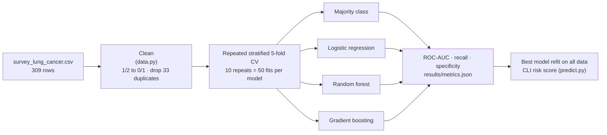
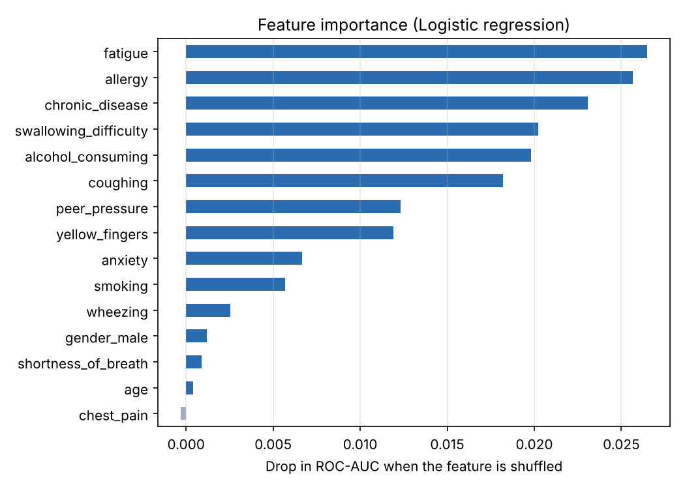

<div align="center">

# Lung Cancer Survey: Risk Screening Model

**A classification model that flags survey respondents for lung cancer follow-up from 15 simple questions (age, gender and 13 yes/no symptoms and habits), evaluated with 50 rounds of cross-validation because the data is small and unbalanced.**

[](https://github.com/Collinsthe4th/cancer-patient-prediction/actions/workflows/ci.yml)
[](https://www.python.org/)
[](https://scikit-learn.org/)

</div>

---

> **Not a medical tool.** This is a learning project built on a public survey of 309 people. It must not be used to diagnose anyone.

## Contents

- [About the project](#about-the-project)
- [Pipeline](#pipeline)
- [Tech stack](#tech-stack)
- [Results](#results)
- [Interactive dashboard](#interactive-dashboard)
- [Getting started](#getting-started)
- [Project structure](#project-structure)
- [Limitations](#limitations)

## About the project

Early screening matters for lung cancer because most cases are found late. A short questionnaire is cheap to run, so the question for this project was simple. How well can the answers to 15 questions separate people with a positive lung cancer label from people without one?

The data is the "Survey Lung Cancer" dataset from Kaggle. It has 309 responses, but 33 of them are exact copies of other rows. I removed them, which left 276 people (238 positive and 38 negative). Every symptom in the raw file is coded as 1 (no) or 2 (yes), so I converted them to 0/1 flags and gave the columns clean names.

## Pipeline



Three choices shaped the evaluation.

1. **Duplicates removed before splitting.** If the same person sits in both the training fold and the test fold, the model is tested on an answer it has already seen, and the score goes up for the wrong reason.
2. **Balanced class weights.** Only 13.8% of respondents are negative. A model that always answers "yes" reaches 86.2% accuracy, so accuracy is not a useful score here. I report ROC-AUC (how well the model ranks positives above negatives), recall (share of positives caught) and specificity (share of negatives correctly cleared).
3. **Repeated cross-validation.** With only 38 negative cases, each test fold holds about 8 of them, so one split can swing the scores a lot. Repeating 5-fold cross-validation 10 times gives a mean and a spread.

## Tech stack

| Area | Tools |
|---|---|
| Data handling | pandas, NumPy |
| Modelling | scikit-learn (logistic regression, random forest, histogram gradient boosting) |
| Evaluation | repeated stratified k-fold, permutation importance |
| Interface | command-line risk score (`lung-cancer-predict`) |
| Testing | pytest, GitHub Actions |

## Results

| Model | ROC-AUC | Recall | Specificity | Balanced accuracy |
|---|---|---|---|---|
| Majority class (baseline) | 0.500 | 1.000 | 0.000 | 0.500 |
| **Logistic regression** | **0.940 ± 0.036** | 0.869 ± 0.054 | 0.809 ± 0.144 | 0.839 ± 0.076 |
| Random forest | 0.930 ± 0.048 | 0.892 ± 0.048 | 0.821 ± 0.153 | 0.857 ± 0.084 |
| Gradient boosting | 0.899 ± 0.070 | 0.910 ± 0.040 | 0.691 ± 0.189 | 0.801 ± 0.097 |

Table 1- Mean ± standard deviation over 50 cross-validation folds (276 respondents).

Logistic regression had the best ROC-AUC (0.940), with the random forest close behind (0.930). The gap between them is smaller than the spread across folds, so I cannot say one is truly better. I kept logistic regression because its coefficients are easy to explain. Gradient boosting was the weakest, and its specificity of 0.691 means it wrongly flags about 3 in 10 negative people. I think the main reason is that a flexible model overfits when it has only about 30 negative cases to learn from in each training fold.



Fig. 1- Permutation importance of each answer for the logistic regression model. Source: Collins Akagha (2026).

The most useful answers were fatigue, allergy, chronic disease, swallowing difficulty and alcohol use. Smoking was much less useful than I expected. Upon further research in the data itself, I found that 50% of negative respondents smoke against 55% of positive respondents, so in this survey smoking barely separates the two groups. This shows that the model learns the patterns of this particular sample, not general medical knowledge.

## Interactive dashboard

The Streamlit app (`streamlit_app.py`) lets you answer the 15 survey questions and see the risk score update straight away. It also shows the model comparison, the most useful answers and how often each group answered yes.

```bash
streamlit run streamlit_app.py
```

## Getting started

```bash
git clone https://github.com/Collinsthe4th/cancer-patient-prediction.git
cd cancer-patient-prediction
python -m venv .venv && source .venv/bin/activate   # Windows: .venv\Scripts\activate
pip install -e . && pip install pytest

python scripts/train.py      # cross-validation, results/metrics.json, figure, saved model
lung-cancer-predict --age 64 --gender M --yes smoking coughing wheezing fatigue allergy
python -m pytest -q
```

The command prints a risk score between 0 and 1 and says whether it is above the follow-up threshold of 0.5. Because the model was trained with balanced class weights, the score ranks people but is not a calibrated probability.

## Project structure

```
cancer-patient-prediction/
├── data/raw/survey_lung_cancer.csv
├── src/lung_cancer/
│   ├── data.py        # cleaning, 0/1 encoding, duplicate removal
│   ├── models.py      # candidate models, repeated cross-validation, metrics
│   └── predict.py     # command-line risk score
├── scripts/train.py   # model comparison, importance plot, final model
├── results/           # metrics.json and figures/
└── tests/             # pytest unit tests on synthetic data
```

## Limitations

The dataset is small (276 unique people), the negative class has only 38 people, and there is no information about how the respondents were chosen or how the label was confirmed. The specificity of the best model also varies a lot between folds (standard deviation of 0.144). Therefore these scores would very likely drop on a new population, and the model should only be read as a demonstration of a careful workflow on unbalanced data.

In conclusion, a simple logistic regression ranked positive respondents above negative ones 94% of the time, and the analysis showed that in this survey the general symptom burden matters more than any single habit such as smoking.
